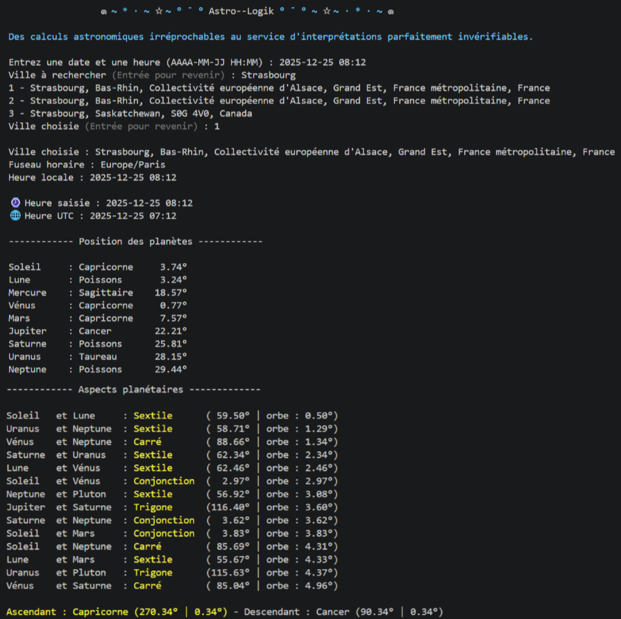

# 🪐 ASTRO-LOGIK

### Des calculs astronomiques irréprochables au service d'interprétations parfaitement invérifiables.

**ASTRO-LOGIK** est un projet Python de calcul astrologique utilisant de véritables données astronomiques fournies par la NASA.

L'objectif est de développer progressivement une application capable de calculer les positions planétaires et de les exploiter dans différents systèmes astrologiques.

> 🔧 **Statut : en développement**  
> Version expérimentale, interface en ligne de commande (CLI).

## ✨ Fonctionnalités actuelles

### 🌍 Données astronomiques

- Récupération des longitudes écliptiques géocentriques via l'API NASA JPL Horizons.
- Calcul des signes du zodiaque occidental à partir des longitudes.
- Calcul de la position en degrés dans chaque signe.
- Affichage des positions de dix corps célestes : Soleil, Lune, Mercure, Vénus, Mars, Jupiter, Saturne, Uranus, Neptune et Pluton.
- Géocodage des lieux via l'API Nominatim (OpenStreetMap).

### 🕒 Dates et calculs temporels

- Saisie et validation du format des dates et heures.
- Conversion de l'heure locale en UTC avec prise en charge des fuseaux horaires.
- Détection des heures ambiguës ou inexistantes lors des changements d'heure.
- Calcul des fractions de journée à partir des heures, minutes et secondes.
- Conversion des dates et heures UTC en jours juliens.
- Calcul du temps sidéral local à partir du temps sidéral de Greenwich et de la longitude géographique.

### 📐 Géométrie astrologique

- Calcul des distances angulaires entre deux positions sur le cercle zodiacal.
- Identification des aspects planétaires selon leurs angles et les tolérances définies.
- Calcul de l'ascendant et du descendant à partir de la date, de l'heure et des coordonnées géographiques.

## 📸 Aperçu du programme



## 🛠️ Technologies utilisées

- **Python** : développement de l'application.
- **Requests** : communication avec les API NASA JPL Horizons et Nominatim.
- **Nominatim (OpenStreetMap)** : géocodage des lieux.
- **datetime** : manipulation des dates et des heures.
- **zoneinfo / tzdata** : gestion des fuseaux horaires.
- **math** : calculs mathématiques et astronomiques.
- **pytest** : tests unitaires automatisés.

## 📁 Architecture du projet

```text
ASTROLOGIK/
├── api/
│   ├── astronomy.py           # API NASA JPL Horizons : positions astronomiques
│   └── geography.py           # API Nominatim : géocodage
│
├── astrology/
│   ├── western.py             # Conversion des longitudes en signes tropicaux
│   ├── geometry.py            # Distances angulaires et formation des paires
│   └── aspects.py             # Identification des aspects selon des règles configurables
│
├── astronomy/
│   ├── coordinates.py         # Calcul des angles ascendant et descendant sur l'écliptique
│   └── time_calculations.py   # Fractions de journée, jours juliens et calculs sidéraux
│
├── tests/                     # Tests automatisés avec pytest
│
├── dates_and_time.py          # Fuseaux horaires, heures ambiguës et conversions UTC
├── display.py                 # Affichage et couleurs du terminal
├── main.py                    # Orchestration du programme
└── user_input.py              # Gestion des saisies utilisateur
```

## 🚀 Installation et utilisation

Cloner le dépôt et se placer dans le dossier du projet.

Créer et activer un environnement virtuel sous Windows :

```powershell
python -m venv .venv
.\.venv\Scripts\Activate.ps1
```

Installer les dépendances :

```powershell
python -m pip install requests tzdata pytest
```

Lancer le programme :

```powershell
python main.py
```

Saisir une date au format `AAAA-MM-JJ HH:MM`.

Remarque : le fuseau horaire est déterminé automatiquement à partir des coordonnées géographiques du lieu sélectionné. Le programme prend également en charge les heures ambiguës ou inexistantes lors des changements d'heure.

Une connexion Internet est nécessaire pour interroger JPL Horizons et Nominatim.

## 🧪 Tests unitaires

Le projet utilise `pytest` pour vérifier les calculs astronomiques, géométriques et temporels.

Lancer les tests :

```powershell
python -m pytest -v
```

**69 tests réussis** lors de la dernière exécution.

Les tests couvrent notamment :

- Les conversions entre heures locales et UTC.
- Les heures d'été et d'hiver et les changements de date.
- Les heures ambiguës ou inexistantes lors des transitions horaires.
- Plusieurs fuseaux horaires internationaux, dont les décalages non entiers.
- Les calculs zodiacaux et les distances angulaires.
- Les aspects planétaires.
- Le calcul du temps sidéral local (comparaison avec calculateur externe).
- Le calcul du temps sidéral de Greenwich (comparaison avec calculateur externe).
- Les fractions de journée et les jours juliens.
- Les années bissextiles et les exceptions du calendrier grégorien.
- Le calcul de l'obliquité moyenne.
- Le calcul de l'ascendant et du descendant (comparaison avec calculateur externe).


## 🔮 Évolutions envisagées

- Calcul Milieu du Ciel, Fond du Ciel et maisons astrologiques.
- Génération d'un thème astral complet.
- Exploration de différents systèmes astrologiques.
- Interprétations astrologiques.
- Enregistrement et consultation des thèmes dans une base SQLite.

## 📚 Objectifs pédagogiques

Ce projet me permet d'approfondir :

- La consommation et l'intégration de plusieurs API REST, ainsi que le traitement de leurs réponses.
- La séparation des responsabilités entre acquisition des données, calculs, saisies utilisateur et affichage.
- Le traitement de données astronomiques.
- La manipulation des dates et des fuseaux horaires.
- Les calculs géométriques et les conversions de coordonnées.
- L'organisation modulaire d'une application Python.
- La conception de fonctions indépendantes et réutilisables.
- Les tests automatisés avec `pytest`, notamment les tests paramétrés et les cas limites.

---

*ASTRO-LOGIK : quand l'astronomie rencontre l'astrologie, sous la surveillance inquiète de Python.* 🪐